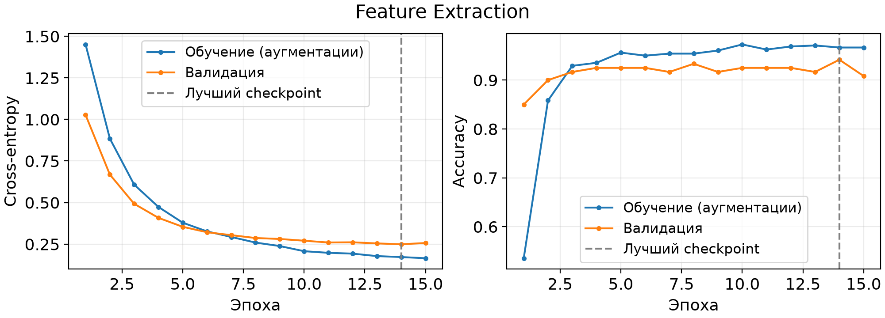
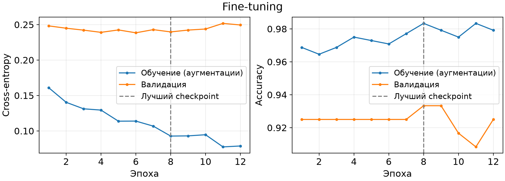

# Классификация пород животных с Transfer Learning

Дополнительная часть лабораторной работы №1: сравнение Feature Extraction и частичного Fine-tuning предобученной MobileNetV3-Small. Обе модели действительно обучены и оценены на общем независимом тесте.

## Данные и модель

[Oxford-IIIT Pet](https://www.robots.ox.ac.uk/~vgg/data/pets/) (Parkhi, Vedaldi, Zisserman, Jawahar; CVPR 2012): Bengal, Birman, British_Shorthair, american_bulldog, beagle, boxer. Всего **1199 фотографий**: train 480, val 120, test 599. На класс приходится 80 train и 20 val; test содержит 100 фотографий каждой породы, кроме boxer (99).

Официальный test сохранён. Из официального trainval стратифицированно выделены 20 изображений каждого класса для валидации с seed=42. Выбраны реальные фотографии высокого разрешения и визуально похожие породы, чтобы проверить, нужна ли адаптация готовых признаков на небольшой выборке.

Архивы загружаются без регистрации с официального сервера, проверяются MD5 из torchvision; SHA-256 архивов сохранены в `results/dataset.json`. В `results/split.csv` указаны идентификаторы, классы, выборки, хеши файлов и декодированных пикселей. Точные дубликаты и пересечения отсутствуют. Проверка похожих снимков одного животного и возможных пересечений с ImageNet не является исчерпывающей.

Данные предоставлены авторами для исследовательских целей; действуют условия исходных владельцев изображений (см. README официального архива annotations). Сырые фотографии в Git не включены. Иллюстрации с небольшим числом примеров используются для анализа учебного эксперимента с указанием источника.

Использована [MobileNetV3-Small](https://docs.pytorch.org/vision/main/models/generated/torchvision.models.mobilenet_v3_small.html) с `MobileNet_V3_Small_Weights.IMAGENET1K_V1`. После `features` и усреднения получаются 576 признаков. Исходная `classifier` целиком заменена на `Dropout(0.2) → Linear(576, 6)`. Всего 930 470 параметров, в новой голове 3462. Небольшая сеть позволила сохранить штатное разрешение 224×224 и выполнить эксперименты на CPU.

## Установка

Команды выполняются **из корня репозитория**. Проверено на Windows, Python 3.12.10; фактическая версия интерпретатора также записана в `results/environment.json`. Рекомендуется отдельное окружение для дополнительной части.

```powershell
python -m venv .venv-tl
.venv-tl\Scripts\python.exe -m pip install torch==2.14.1 torchvision==0.29.1 --index-url https://download.pytorch.org/whl/cpu
.venv-tl\Scripts\python.exe -m pip install -r transfer_learning/requirements.txt
```

В Linux/macOS путь интерпретатора окружения — `.venv-tl/bin/python`. Для NVIDIA GPU установите совместимые CUDA-сборки PyTorch и torchvision по [официальной инструкции](https://pytorch.org/get-started/locally/); скрипт автоматически использует CUDA при её доступности. Детерминированность внутри одной среды включена; побитовое совпадение между разными устройствами и версиями библиотек не гарантируется.

Для первого запуска нужен доступ к официальному серверу Oxford и download.pytorch.org. Суммарный размер скачиваемых архивов около 811 МБ; распаковываются только нужные изображения и текстовые аннотации. Данные, веса и кэши сохраняются в каталоге модуля. Список фактически установленных зависимостей приведён в `requirements-lock.txt` (CPU, Windows); `requirements.txt` фиксирует основные библиотеки.

## Запуск с нуля

Для первого запуска без существующих локальных чекпоинтов:

```powershell
.venv-tl\Scripts\python.exe transfer_learning/prepare.py
.venv-tl\Scripts\python.exe transfer_learning/train.py
.venv-tl\Scripts\python.exe transfer_learning/analyze.py
.venv-tl\Scripts\python.exe transfer_learning/verify.py --full
```

Для независимого повторения с сохранением опубликованных результатов используйте новые каталоги:

```powershell
.venv-tl\Scripts\python.exe transfer_learning/prepare.py --output transfer_learning/.cache/repeat/results
.venv-tl\Scripts\python.exe transfer_learning/train.py --output transfer_learning/.cache/repeat/results --checkpoints transfer_learning/.cache/repeat/checkpoints
.venv-tl\Scripts\python.exe transfer_learning/analyze.py --output transfer_learning/.cache/repeat/results
.venv-tl\Scripts\python.exe transfer_learning/verify.py --full --output transfer_learning/.cache/repeat/results --checkpoints transfer_learning/.cache/repeat/checkpoints
```

Другие параметры задаются JSON-файлом через `--config` в `prepare.py` и `train.py`. Порядок классов используется как порядок меток. Этот эксперимент фиксирует 224×224; произвольный размер запрещён проверкой, чтобы валидация не расходилась с preset весов. При смене классов нужно также адаптировать русские подписи иллюстраций в `analyze.py`; воспроизведение выбранного эксперимента не требует изменения кода.

## Восстановление и проверка

```powershell
.venv-tl\Scripts\python.exe transfer_learning/train.py --resume
.venv-tl\Scripts\python.exe transfer_learning/train.py --evaluate-only
.venv-tl\Scripts\python.exe transfer_learning/analyze.py
.venv-tl\Scripts\python.exe transfer_learning/verify.py --full
.venv-tl\Scripts\python.exe transfer_learning/check_resume.py
```

`--resume` читает `*_last.pt`, проверяет конфигурацию и хеш разбиения, восстанавливает оптимизатор и начинает следующую эпоху. Если процесс прервался посреди эпохи, она повторяется. Seed задаётся отдельно для каждой эпохи; best и last записываются атомарно. `check_resume.py` создаёт временные копии, восстанавливает работу из более ранних best-чекпоинтов и сравнивает итоговые тензоры, численные метрики и прогнозы с завершённым запуском. Фактическая проверка прошла с точным совпадением.

`verify.py` без `--full` проверяет опубликованные CSV/JSON без скачивания данных и весов: целостность разбиения, идентичность теста, метрики sklearn, независимую арифметику по матрицам ошибок, вероятности, loss и выбор лучших эпох. `--full` дополнительно проверяет файлы изображений, исходные ImageNet-тензоры, хеши чекпоинтов и повторно вычисляет тестовые ответы. Полная проверка требует локальных данных и чекпоинтов после обучения.

## Протокол

| Параметр | Feature Extraction | Fine-tuning |
|---|---|---|
| Начало | ImageNet + новая голова | Лучшая модель Feature Extraction целиком |
| Обучаемые слои | classifier | features.9–12 и classifier |
| Обучаемые параметры | 3462 | 739 950 |
| Эпохи | 15 | 12 |
| Оптимизатор | AdamW | AdamW |
| LR головы | 0.001 | 0.0001 |
| LR базы | заморожена | 0.00001 |
| Weight decay | 0.0001 | 0.0001 |
| Batch size | 32 | 32 |

Для train: RandomResizedCrop 224 (scale 0.7–1.0, стандартный ratio 3/4–4/3), горизонтальное отражение p=0.5 и нормализация ImageNet. Для val/test: официальный preset весов (Resize 256, CenterCrop 224, ToTensor, нормализация). Все BatchNorm работают в eval, их статистики фиксированы; affine-параметры размороженных блоков обучаются в Fine-tuning. Dropout активен только при обучении. Замороженные параметры и буферы проверяются хешированием после каждой эпохи.

Лучший checkpoint: максимум val accuracy, при равенстве — минимум val loss, при полном равенстве — ранняя эпоха. Тест применяется только после завершения обеих стадий и не используется для подбора параметров.

## Результаты

| Метрика на 599 test-изображениях | Feature Extraction | Fine-tuning |
|---|---:|---:|
| Accuracy | 95.4925% | 94.9917% |
| Precision macro | 0.955009 | 0.950753 |
| Recall macro | 0.954848 | 0.949848 |
| F1 macro | 0.954797 | 0.949871 |
| Precision weighted | 0.955101 | 0.950822 |
| Recall weighted | 0.954925 | 0.949917 |
| F1 weighted | 0.954881 | 0.949939 |
| Верные ответы | 572 | 569 |
| Лучшая эпоха стадии | 14 | 8 |
| Val accuracy лучшей эпохи | 94.1667% | 93.3333% |
| Test cross-entropy | 0.205084 | 0.182497 |

Fine-tuning исправил 2 ошибки и добавил 5, снизив accuracy на 0.5008 п.п. Парный bootstrap (10 000 повторов, seed=42) дал 95%-й интервал разности accuracy B−A от −1.3356 до +0.3339 п.п. Интервал включает ноль: устойчивое преимущество не установлено. Test loss снизился, поскольку учитывает вероятности истинных классов, а accuracy — только argmax.

В этом запуске Feature Extraction предпочтительнее по accuracy, macro F1 и числу обучаемых параметров. Во время Fine-tuning train loss продолжает падать, а val loss к концу возрастает, что согласуется с началом переобучения. Основная путаница — между породами собак. Значения для отдельных классов и матрицы ошибок находятся в `results/metrics.json`.

Время эпох с валидацией: 95.7 с для A и ещё 98.8 с для B на Ryzen 7 5700U, CPU, 6 потоков; это не включает скачивание, подготовку и финальную оценку. Ограничения: один seed, маленькая валидация, шесть пород, возможная близость к ImageNet; не проводился контроль продолжения обучения одной головы при таком же дополнительном бюджете эпох. Bootstrap не оценивает вариативность повторного обучения.




## Файлы

- `config.json` — фиксированные параметры.
- `prepare.py` — загрузка с проверкой контрольных сумм, разбиение и хеширование.
- `train.py` — обучение, сохранение, восстановление, оценка.
- `analyze.py` — метрики, парный bootstrap, таблица сравнения и иллюстрации.
- `verify.py`, `check_resume.py` — проверки численных результатов и восстановления.
- `results/*_history.json` — настоящие метрики всех эпох и время.
- `results/*_training.json` — лучшие эпохи, обучаемые параметры и хеши состояний.
- `results/*_predictions.csv` — метки и вероятности всех тестовых изображений.
- `results/*_evaluation.json` — loss и accuracy лучших моделей на train/val/test без аугментаций.
- `results/metrics.json`, `comparison.csv` — сводные и поклассовые метрики.
- `results/verification.json`, `verification_full.json`, `resume_verification.json` — итоги воспроизводимых проверок.
- `results/figures/` — графики, матрицы ошибок и реальные примеры; `illustrations.json` фиксирует правила и идентификаторы отбора.

Чекпоинты находятся локально в `checkpoints/`, исходные данные в `data/`, кэши в `.cache/`. Они исключены из Git и восстанавливаются запуском инструкций выше.
